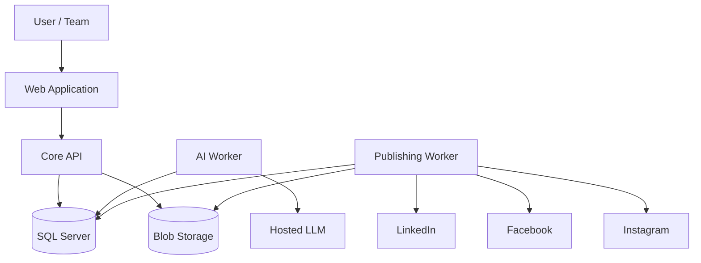
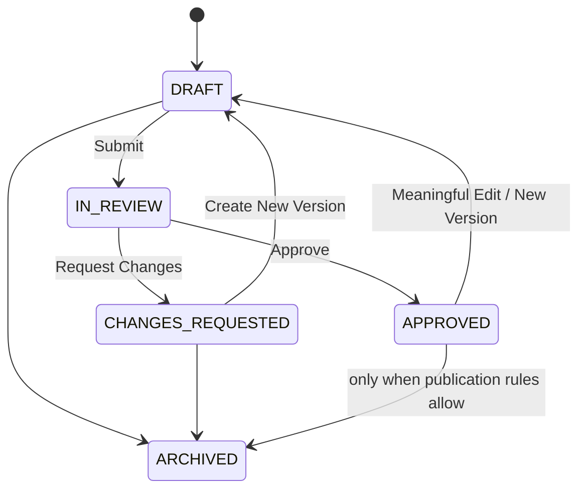
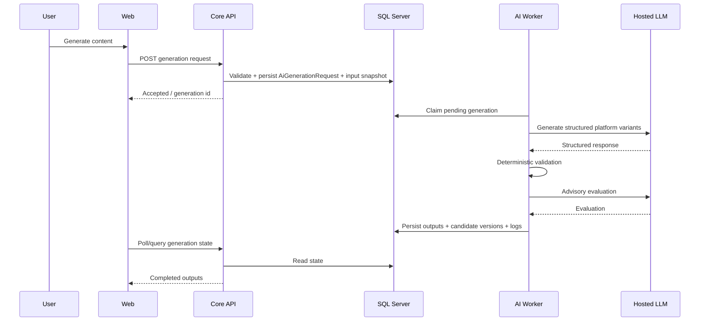
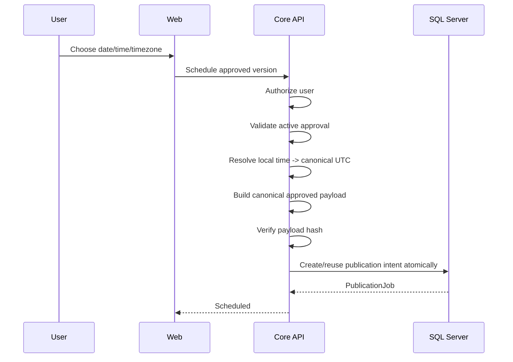
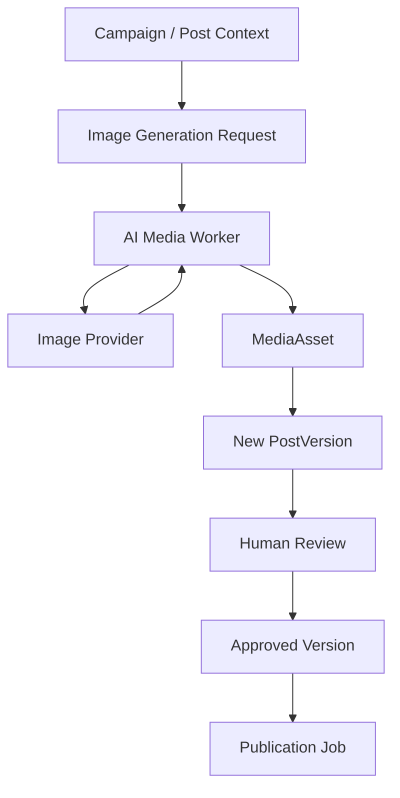

# ARCHITECTURE.md — Social Media Content Automation Engine

## 1. Purpose

This document defines **how the Social Media Content Automation Engine is structured, how its components interact, where business rules live, how data moves through the system, and which technical boundaries must not be crossed**.

This file is the technical source of truth for implementation.

Read together with:

- `README.md` — what the project is and how to run it
- `PRD.md` — what the product must do and why
- `AGENTS.md` — rules the coding agent must follow
- `TASKS.md` — implementation order

If implementation code conflicts with this architecture, the architecture must be reviewed before the code is allowed to redefine the system.

---

# 2. Architecture Goals

The architecture is designed around a one-week MVP, but the core business boundaries must remain production-sensible.

Primary goals:

1. Keep one clear source of truth
2. Preserve tenant isolation
3. Keep AI separate from authorization and publishing decisions
4. Bind approval to immutable content versions
5. Make scheduling durable and independent of the browser
6. Make provider outcomes truthful
7. Prevent unsafe duplicate publishing
8. Make failures visible and recoverable
9. Keep external provider integrations replaceable
10. Allow future AI capabilities, including image generation, without redesigning the core workflow

The architecture deliberately avoids premature microservices.

---

# 3. High-Level System Shape

The MVP is a **modular monolith with durable background workers**.

```text
User
  |
  v
Web Application
  |
  v
Core API
  |
  +--------------------------+
  |                          |
  v                          v
SQL Server                Blob Storage
  |
  +--------------------------+
  |                          |
  v                          v
AI Worker               Publishing Worker
  |                          |
  v                          v
Hosted LLM              Provider Adapters
                             |
                 +-----------+-----------+
                 |           |           |
                 v           v           v
             LinkedIn    Facebook    Instagram
```

External services are dependencies, not sources of business truth.

The system's authoritative state remains in SQL Server.

---

# 4. Core Architectural Decision

The MVP uses:

- Angular web application
- modular ASP.NET Core backend
- SQL Server as the authoritative relational store
- durable .NET AI worker
- durable .NET publishing worker
- object/blob storage for immutable media
- hosted LLM for text generation/evaluation
- social-provider APIs where access is available

A separate Python AI service is **not part of the one-week MVP**.

Python may become a future extraction boundary only if advanced requirements such as RAG, document ingestion, custom ML, embedding pipelines, computer vision, or model-heavy orchestration create a real reason for it.

---

# 5. Architectural Principles

## 5.1 The Core API owns business decisions

The Core API owns:

- authentication context
- workspace membership checks
- permission checks
- campaign rules
- version creation rules
- review rules
- approval integrity
- scheduling rules
- idempotency rules
- publication-intent creation
- audit creation
- notification creation

AI does not own these decisions.

Provider adapters do not own these decisions.

The browser does not own these decisions.

## 5.2 SQL Server is the business source of truth

The database owns durable truth for:

- workspace state
- campaign state
- content versions
- review decisions
- AI job status
- social destinations
- publication intent
- publication outcome
- audit history

Workers process database-backed work.

They do not rely on in-memory timers for correctness.

## 5.3 Public-facing content is versioned

A reviewed or approved version is immutable.

Meaningful public-facing edits produce a new `PostVersion`.

Never modify an already reviewed version in place.

## 5.4 Editorial state and delivery state are different

Editorial state belongs to the Post.

Delivery state belongs to a PublicationJob.

Do not mix them.

## 5.5 External side effects are treated carefully

Publishing to a social provider is an external side effect.

The architecture must never assume a timeout means "nothing happened".

Unknown external outcomes require reconciliation.

---

# 6. System Context

The system has five major runtime concerns:

1. User-facing application
2. Core transactional backend
3. Durable AI processing
4. Durable publication processing
5. External provider integrations



---

# 7. Component Responsibilities

## 7.1 Web Application

The web application handles presentation and user interaction.

Responsibilities:

- sign-in experience
- workspace selection
- dashboard
- brand settings
- campaign forms
- campaign facts
- content editor
- version history display
- review queue
- review screen
- media upload UI
- destination selection
- scheduling UI
- publishing/history UI
- notifications
- settings

The web application may improve UX by hiding or disabling invalid actions.

However, frontend visibility is not authorization.

The backend must re-check every important rule.

---

## 7.2 Core API

The Core API is the central application boundary.

Responsibilities:

- authenticated user resolution
- active workspace resolution
- tenant authorization
- permission enforcement
- request validation
- concurrency checks
- campaign management
- content/version management
- review workflow
- approval binding
- AI job creation
- media metadata management
- social connection orchestration
- publication-intent creation
- notification creation
- audit logging
- dashboard/calendar queries

The Core API must not directly hold open a user HTTP request while waiting for long-running AI generation or scheduled publication.

Long-running work becomes durable background work.

---

## 7.3 SQL Server

SQL Server stores authoritative structured state.

It contains logical entity groups for:

### Identity and tenancy

- Organizations
- Users / identity references
- OrganizationMembers

### Business context

- BrandProfiles
- Campaigns
- CampaignFacts

### Content and review

- Posts
- PostVersions
- ReviewRequests
- ReviewComments
- ContentEvaluations

### AI operations

- AiGenerationRequests
- AiCallLogs
- AiRequestOutputs

### Social and media

- OAuthConnections
- OAuthStates
- SocialAccounts
- MediaAssets

### Delivery and operations

- PublicationJobs
- PublicationAttempts
- Notifications
- AuditLogs
- ApiIdempotencyKeys

---

## 7.4 Blob/Object Storage

Blob storage owns immutable file content.

Examples:

- uploaded social images
- future AI-generated images
- provider-ready media assets where appropriate

SQL Server stores media metadata and identity.

Blob storage stores the bytes.

Do not store large media files directly inside ordinary relational business rows.

---

## 7.5 AI Worker

The AI worker processes durable AI generation requests.

Responsibilities:

- claim pending AI jobs
- load frozen input snapshot
- build generation prompt
- call hosted LLM
- validate structured output
- run deterministic validation
- run advisory evaluation
- persist candidate outputs
- create candidate PostVersions through the controlled application persistence path
- write call logs
- capture model/prompt/schema versions
- record token/latency/cost metadata where available
- handle bounded retries and explicit failure

The AI worker does not:

- approve content
- create publication jobs
- access social credentials
- change user permissions
- publish social content

### 7.5.1 Hosted LLM configuration (owner-approved, 2026-10-04)

The hosted LLM is configured per workspace by an Admin in the web app (Settings → AI settings), not in deployment config:

- Providers: OpenAI, Groq, or any OpenAI-compatible endpoint (https; plain http only for loopback hosts such as a local Ollama). Infrastructure uses one OpenAI-compatible chat-completions adapter in JSON-object mode; the Application layer validates its own versioned output schema.
- The model is picked from the provider's `/models` list or typed in.
- The API key is stored in `AiProviderSettings` encrypted with ASP.NET Core Data Protection. The API (which stores it) and the AI worker (which uses it) share one key ring. The key is never returned to the browser, placed in prompts or logs, or sent to a different endpoint than the one it was entered for.
- Each `AiGenerationRequest` snapshots provider and model. If the workspace switches provider before the worker runs, the request fails (`AI_NOT_CONFIGURED`) instead of running against a different provider.

---

## 7.6 Publishing Worker

The publishing worker processes durable publication jobs.

Responsibilities:

- claim due jobs
- acquire a lease
- revalidate approved/current version
- verify destination/account mode
- verify payload hash
- create provider-specific payload
- prepare media delivery URL
- call provider adapter
- persist checkpoints
- classify errors
- schedule safe retries
- mark action-required failures
- mark reconciliation-required unknown outcomes
- persist confirmed external IDs/URLs
- record publication attempts
- update user-visible operational result

The publishing worker must never blindly republish an uncertain external side effect.

---

# 8. Domain Ownership Model

The organization/workspace owns business data.

```text
Organization
  |
  +-- OrganizationMembers
  |
  +-- BrandProfile
  |
  +-- Campaigns
  |     |
  |     +-- CampaignFacts
  |     |
  |     +-- Posts
  |            |
  |            +-- PostVersions
  |            +-- ReviewRequests
  |            |      |
  |            |      +-- ReviewComments
  |            |
  |            +-- ContentEvaluations
  |            +-- PublicationJobs
  |
  +-- SocialAccounts
  +-- MediaAssets
  +-- Notifications
  +-- AuditLogs
```

A user may belong to multiple organizations.

A business record belongs to one organization.

---

# 9. Tenant Isolation

Tenant isolation must exist at the backend and database relationship level.

Every tenant-owned entity contains `OrganizationId`.

Important relationships should use organization-scoped foreign-key patterns where practical.

Example rule:

A Post cannot reference:

- a Campaign from another organization
- a MediaAsset from another organization
- a SocialAccount from another organization
- a ReviewRequest from another organization

Every request resolves:

```text
Authenticated User
      |
      v
Organization Membership
      |
      v
Required Permission
      |
      v
Resource OrganizationId
```

If any check fails, access is denied.

---

# 10. Core Business Aggregate Boundaries

The architecture should treat these as the most important business aggregates:

## 10.1 Campaign aggregate

Owns:

- campaign intent (objective, description)
- audience
- CTA and CTA URL
- campaign facts
- platform selection (normalized `CampaignPlatforms` rows, same-tenant composite FK)
- high-level editorial inputs (tone override, length, hashtag and emoji modes)

## 10.2 Post aggregate

Owns:

- platform identity
- editorial state
- CurrentVersionId
- active approval relationship
- immutable version history

## 10.3 Review aggregate

Owns:

- exact submitted PostVersionId
- submitter
- reviewer
- review decision
- comments
- timestamps

## 10.4 PublicationJob aggregate

Owns:

- exact PostVersionId
- exact destination
- execution mode snapshot
- approved payload snapshot
- scheduled time
- worker lease
- attempt state
- external provider evidence
- delivery state

---

# 11. Post and Version Architecture

One selected platform produces one independently managed Post.

Example:

```text
Campaign 100
  |
  +-- Post A -> LinkedIn
  +-- Post B -> Facebook
  +-- Post C -> Instagram
```

Each Post has its own version history.

```text
Post A
  |
  +-- Version 1 (AI generated)
  +-- Version 2 (manual edit)
  +-- Version 3 (rewrite after reviewer feedback)
```

The Post points to:

- `CurrentVersionId`
- active editorial state

Approval references an exact PostVersion.

Previously reviewed versions remain immutable.

---

# 12. Approval Binding

Approval must be bound to the exact public payload.

The normalized approval identity includes:

- Platform
- SocialAccountId
- Hook
- Body/Caption
- CTA
- DestinationUrl
- Hashtags
- MediaAssetId
- immutable media object identity
- media content hash
- alt text
- canonical renderer/payload version

A canonical payload is serialized deterministically.

A payload hash is computed from that canonical representation.

Short-lived delivery URLs are not part of immutable approval identity.

---

# 13. Editorial State Machine

The Post uses this state machine:



Rules:

- only current valid versions can be submitted
- approval applies only to the submitted version
- approved content is not mutated
- meaningful edits create a new DRAFT version
- delivery state is not stored here

---

# 14. Review Workflow

## 14.1 Submit

The Core API verifies:

- current version exists
- version belongs to Post
- selected destination belongs to workspace
- required media exists
- critical automated blockers are resolved
- concurrency token is current
- user has permission

Then it creates a ReviewRequest linked to the exact PostVersion.

## 14.2 Review

Reviewer sees:

- campaign intent
- selected platform
- selected destination
- exact caption
- media preview
- version number
- facts
- warnings
- comments/history

## 14.3 Decision

Reviewer chooses:

- Approve
- Request Changes

Approval transaction updates:

- review decision
- active approval pointer/reference
- Post editorial state
- notification
- audit record

All must commit atomically.

---

# 15. Distinct Reviewer Policy

Workspace policy:

`RequireDistinctReviewer`

When ON:

- submitter cannot approve the submitted version
- last meaningful human editor cannot approve that same version

For manager demo:

`RequireDistinctReviewer = true`

This rule belongs in server-side business logic.

---

# 16. AI Generation Architecture

AI generation is asynchronous and durable.



---

# 17. AI Input Snapshot

An AI generation request must preserve the input used for that generation.

The snapshot should include resolved values such as:

- organization identity
- brand profile revision
- campaign identity
- campaign objective
- target audience
- campaign facts
- campaign description
- CTA and CTA URL
- platform list
- editorial preferences
- prompt version
- output schema version

Future changes to the BrandProfile must not silently rewrite historical AI provenance.

---

# 18. AI Output Contract

The LLM must return structured content, not free-form prose that the application heuristically parses.

Conceptual output:

```json
{
  "campaignStrategy": {
    "primaryAngle": "string",
    "valueProposition": "string"
  },
  "variants": [
    {
      "platform": "LINKEDIN",
      "hook": "string",
      "body": "string",
      "cta": "string",
      "hashtags": ["string"]
    }
  ]
}
```

The exact contract is defined in `PROJECT_SPEC` / API schema implementation.

The architecture requirement is:

- structured
- versioned
- validated
- deterministic enough for reliable persistence

---

# 19. AI Evaluation

The evaluation is advisory.

It may score/check:

- brand alignment
- audience relevance
- clarity
- platform fit
- CTA fit
- unsupported claim risk
- contradictory claims

Deterministic rules remain separate.

Examples of deterministic checks:

- output schema validity
- URL rules
- prohibited terms
- platform key presence
- caption length
- supported media conditions
- fact-reference validity

AI does not replace deterministic validation.

---

# 20. AI Rewrite Architecture

A rewrite is a new durable AI operation.

Input includes:

- exact existing PostVersion
- requested rewrite action
- brand/campaign context
- relevant facts
- platform rules

Output creates a new candidate PostVersion.

The old PostVersion remains unchanged.

Supported MVP rewrite actions may include:

- Shorten
- Expand
- More Professional
- Improve Hook
- Less Promotional
- Custom

---

# 21. Future AI Image Generation Architecture

AI image generation is **not required for the one-week MVP**, but the architecture must allow it later without changing approval, media, or publishing rules.

> **Implemented 2026-10-05 (approved scope change, PRD §22.1)** exactly along this design: `IImageGenerationProvider`
> (OpenAI-compatible `images/generations`), a durable `ImageGeneration` AiGenerationRequest processed by the AI worker,
> an `AI_GENERATED` MediaAsset (bytes in object storage, metadata in SQL), and a new PostVersion (`AiImage` source) that
> goes through human review. Configuration lives in `/internal/ai`; the key is in the secret store.
> **2026-10-07:** a second adapter, `HuggingFaceImageClient`, serves Hugging Face text-to-image models (default
> `Tongyi-MAI/Z-Image-Turbo`; also `black-forest-labs/FLUX.1-schnell`, `Efficient-Large-Model/SANA1.5_1.6B_1024px_diffusers`)
> through the HF Inference Providers router (fal-ai route). `ImageGenerationRouter` picks the adapter by provider; the
> governance flow above is unchanged. A Hugging Face image model needs a Hugging Face token (the image key, or the LLM key
> only when the LLM provider is also Hugging Face).

## 21.1 Design principle

Generated images are treated as media assets.

They do not bypass the normal content workflow.

Future flow:

```text
Campaign / Post Context
        |
        v
Image Generation Request
        |
        v
AI Media Worker / Provider Adapter
        |
        v
Generated Image
        |
        v
MediaAsset
        |
        v
Attached to New PostVersion
        |
        v
Human Review
        |
        v
Approval
        |
        v
Publication Job
```

## 21.2 Future image-generation request

A future request can contain:

- campaign identity
- target platform
- desired visual concept
- brand style guidance
- required aspect ratio
- prohibited visual elements
- optional source/reference media identity
- prompt template version
- image provider/model version

## 21.3 Provider abstraction

Do not hard-code the core domain to one image-generation vendor.

Use a future contract similar to:

```text
ImageGenerationProvider
  - GenerateAsync()
  - GetResultAsync()
  - NormalizeError()
```

Possible provider implementations may be added later.

## 21.4 Persistence

Generated image bytes go to Blob Storage.

SQL stores:

- MediaAssetId
- OrganizationId
- source type = AI_GENERATED
- provider/model metadata
- generation request id
- immutable object key
- file hash
- width
- height
- MIME type
- moderation/safety result when available
- created timestamp

## 21.5 Approval behavior

An AI-generated image is not automatically approved.

Attaching or replacing an image creates a new PostVersion.

The image identity and alt text become part of the approved payload.

The same review workflow applies.

## 21.6 Publishing behavior

Publishing workers do not care whether media came from:

- human upload
- AI image generation
- future approved media library

They publish the immutable approved MediaAsset.

This is the key extensibility point.

## 21.7 Future image-generation safety

Future implementation must support:

- content-policy checks
- user-visible generation failures
- provenance metadata
- no silent overwrite of approved media
- no generation of provider credentials into prompts
- usage/cost logging
- human review before publication

---

# 22. Media Architecture

The MediaAsset is the canonical media identity.

SQL metadata:

- MediaAssetId
- OrganizationId
- original filename
- MIME type
- width/height
- size
- SHA-256 hash
- immutable object key
- source type
- created by / generated by
- created at

Blob storage:

- immutable bytes

Provider delivery:

- short-lived signed/provider-readable URL created at dispatch time

Do not place temporary signed URLs inside approval identity.

---

# 23. Social Connection Architecture

A SocialAccount is the business destination.

An OAuthConnection represents credential/grant information needed to access provider APIs.

An OAuthState is temporary callback protection.

Conceptual relationship:

```text
Organization
   |
   +-- OAuthConnection
   |      |
   |      +-- credential/grant metadata
   |
   +-- SocialAccount
          |
          +-- provider destination
          +-- execution mode
          +-- external account/page/profile id
```

Avoid overengineering these models for MVP.

---

# 24. Social Execution Modes

Every SocialAccount has a current mode:

- `LIVE`
- `TEST_ACCOUNT`
- `SIMULATED`
- `NOT_CONFIGURED`

At job creation, PublicationJob snapshots the mode.

Historical delivery truth must not change if the SocialAccount mode changes later.

Rules:

- `LIVE` / `TEST_ACCOUNT` can result in `PUBLISHED`
- `SIMULATED` results in `SIMULATED`
- `NOT_CONFIGURED` cannot create an executable publication job

---

# 25. Publication Intent Architecture

PublicationJob is the durable publication intent.

It references:

- OrganizationId
- PostId
- PostVersionId
- active approval/review identity
- SocialAccountId
- execution-mode snapshot
- frozen approved payload
- payload hash
- scheduled UTC instant
- original local date/time/timezone
- attempt policy
- current delivery state
- lease/checkpoint data
- provider/external result

A successful publication job is never reactivated.

---

# 26. Scheduling Flow



---

# 27. Publish Now Flow

Publish Now is scheduling with an immediately due time.

It must still create a PublicationJob.

Never perform direct provider publishing inside the browser request.

Correct:

```text
Publish Now
  |
  v
Validate approved version
  |
  v
Create immediately due PublicationJob
  |
  v
Publishing Worker
  |
  v
Provider Adapter
```

Incorrect:

```text
Button -> API -> LinkedIn directly
```

---

# 28. Time Architecture

User input uses:

- local date
- local time
- IANA timezone

Server resolves:

- nonexistent local time
- ambiguous DST transition
- selected offset when ambiguity requires user choice
- canonical UTC instant

Store:

- PublishAtUtc
- original local date/time
- original IANA timezone
- selected offset if applicable

Workers operate on UTC.

UI displays user/workspace-local time.

---

# 29. Publishing Worker Claiming

Workers claim a small batch using a short SQL transaction.

Conceptual flow:

```text
Find due jobs
   |
   v
Claim + lease token
   |
   v
Commit
   |
   v
Release DB lock
   |
   v
Perform external work
```

Never hold a SQL transaction open during a network call.

Lease fields may include:

- LockedBy
- LockedAtUtc
- LeaseExpiresAtUtc
- LeaseToken

Later updates must include the lease token as a fencing condition.

A stale worker must not overwrite newer job state.

---

# 30. Dispatch Revalidation

Immediately before provider mutation, the publishing worker revalidates:

- workspace is active
- PostVersion still exists
- active approval still references that version
- destination matches approved destination
- execution mode is valid
- payload hash matches approved payload
- account credentials/capability are usable
- media exists
- late-job policy allows dispatch

If validation fails before external send, job becomes appropriate blocked/action-required state.

---

# 31. Provider Adapter Architecture

Use a common contract.

Conceptually:

```text
ISocialPublisher
  - ValidateCapabilityAsync()
  - PrepareAsync()
  - PublishAsync()
  - GetStatusAsync()
  - NormalizeError()
```

Implementations:

- LinkedInPublisher
- FacebookPublisher
- InstagramPublisher
- SimulatedPublisher

The core worker should not contain provider-specific conditionals scattered across business code.

---

# 32. Instagram Multi-Step Publishing

Instagram may require multi-stage media processing.

The worker must persist checkpoints.

Conceptual flow:

```text
Create media container
   |
   v
Persist provider container id
   |
   v
WAITING_MEDIA
   |
   v
NextActionAtUtc
   |
   v
Check readiness
   |
   v
Publish container
```

Do not sleep inside a long-running HTTP request or database transaction.

---

# 33. Publication Delivery States

PublicationJob delivery state:

- `SCHEDULED`
- `PROCESSING`
- `WAITING_MEDIA`
- `RETRY_PENDING`
- `ACTION_REQUIRED`
- `RECONCILIATION_REQUIRED`
- `PUBLISHED`
- `SIMULATED`
- `FAILED`
- `CANCELED`

Meaning:

### SCHEDULED

Waiting until due.

### PROCESSING

Currently owned by worker lease.

### WAITING_MEDIA

Provider-side media is still processing.

### RETRY_PENDING

A known-safe retryable failure is waiting for backoff.

### ACTION_REQUIRED

Human intervention required.

Examples:

- expired/revoked auth
- invalid media
- missing provider permission
- excessive lateness

### RECONCILIATION_REQUIRED

The external side effect may have happened.

Do not automatically publish again.

### PUBLISHED

External provider success confirmed.

### SIMULATED

Simulation completed.

Not externally published.

### FAILED

Permanent failure or retry limit.

### CANCELED

Safely canceled before external side effect.

---

# 34. Retry Architecture

Retries are bounded.

Retry only when provider semantics establish that retry is safe.

Possible safe cases:

- pre-send network failure
- documented throttling
- explicit provider retryable response with no created post
- internal temporary dependency failure before dispatch

Unsafe/uncertain cases:

- timeout after send
- provider server error after create request may have succeeded
- lease lost after dispatch
- provider success received but DB persistence failed

Unsafe/uncertain cases become:

`RECONCILIATION_REQUIRED`

---

# 35. Duplicate Protection

The system does not claim mathematically perfect exactly-once delivery across external providers.

It implements controlled effectively-once behavior.

Layers:

1. one lifetime publication intent per version + destination
2. API idempotency key
3. unique database constraint
4. worker lease
5. lease fencing
6. pre-dispatch validation
7. external provider id when returned
8. dispatch checkpoint
9. reconciliation for uncertain outcomes

Never solve uncertain publish state with blind retry.

---

# 36. Database Integrity Rules

Important constraints include:

- unique OrganizationId + UserId membership
- unique PostId + VersionNumber
- at most one active/pending review per Post
- one AI request output per request + platform variant
- one lifetime publication intent per OrganizationId + PostVersionId + SocialAccountId
- same-tenant composite relationships where practical
- CurrentVersionId must belong to same Post
- active approval must reference current eligible version before scheduling
- JSON columns require valid JSON plus application DTO validation
- mutable aggregates use rowversion/concurrency token

---

# 37. Atomic Transaction Boundaries

Keep transactions short.

## 37.1 New Post + Version

Atomic:

- insert Post
- insert Version 1
- update CurrentVersionId

## 37.2 Approval

Atomic:

- write review decision
- set active approval reference
- set Post editorial state APPROVED
- create notification
- create audit event

## 37.3 Schedule

Atomic:

- validate current approval
- create/reuse publication intent
- save idempotency result
- create audit event

## 37.4 Cancel and edit

Atomic when cancellation is still safe:

- cancel safe publication job
- revoke active approval
- create new PostVersion
- update CurrentVersionId
- set DRAFT
- audit

Never hold these transactions open during LLM/social network calls.

---

# 38. Concurrency Architecture

Mutable aggregates use SQL Server `rowversion` or equivalent concurrency tokens.

Requests that depend on current state carry:

- `If-Match`
- expected rowversion
- or equivalent explicit concurrency contract

If stale:

- one request succeeds
- stale request receives conflict
- client reloads

Do not silently overwrite current state.

---

# 39. API Architecture

Business API prefix:

```text
/api/v1/organizations/{orgId}/...
```

Identity/workspace discovery may live outside this path.

Logical route groups:

- `/me`
- `/organizations`
- `/brand-profile`
- `/campaigns`
- `/campaign-facts`
- `/ai-generations`
- `/posts`
- `/versions`
- `/rewrites`
- `/review-requests`
- `/comments`
- `/media`
- `/social-connections`
- `/social-accounts`
- `/publication-jobs`
- `/calendar`
- `/notifications`
- `/dashboard`
- `/audit`

Workflow actions use explicit endpoints/commands.

Do not allow frontend to arbitrarily patch state strings.

---

# 40. API Command Principle

Correct:

```text
POST /posts/{id}/submit-review
POST /review-requests/{id}/approve
POST /review-requests/{id}/request-changes
POST /posts/{id}/schedule
POST /publication-jobs/{id}/cancel
```

Avoid:

```text
PATCH /posts/{id}
{
  "status": "APPROVED"
}
```

State transitions belong to application commands.

---

# 41. Error Model

The API should expose stable machine-readable error codes.

Examples:

- `UNAUTHORIZED`
- `FORBIDDEN`
- `TENANT_MISMATCH`
- `VALIDATION_FAILED`
- `CONCURRENCY_CONFLICT`
- `INVALID_STATE_TRANSITION`
- `APPROVAL_REQUIRED`
- `APPROVAL_STALE`
- `SOCIAL_ACCOUNT_NOT_READY`
- `AI_GENERATION_FAILED`
- `IDEMPOTENCY_CONFLICT`
- `PUBLICATION_TOO_LATE_TO_CANCEL`

User-facing text can change.

Machine error codes should remain stable.

---

# 42. Notification Architecture

Notifications are durable in-app events for user workflow.

Examples:

- review requested
- changes requested
- approved
- scheduled
- published
- simulated
- failed
- action required
- reauthorization required

Notifications are not the audit log.

---

# 43. Audit Architecture

Audit records answer:

- who
- did what
- to which resource
- when
- under which organization

Audit should capture high-value business actions.

Do not put secrets or sensitive provider credentials into audit metadata.

---

# 44. Authentication and Authorization Boundary

The browser receives only what it needs for authenticated product use.

MVP implementation (pending owner confirmation): the Core API signs users in with email and password (PBKDF2 hashes in `Users`) and issues an HttpOnly, SameSite=Strict session cookie that carries only the user id. Organization context always comes from the request route and is re-authorized against `OrganizationMembers` on every request by the Application-layer `OrganizationAuthorizer` (authenticated user → active membership → role permission → resource `OrganizationId`).

Provider credentials remain backend-only.

Rules:

- no social tokens in localStorage
- no provider access tokens in AI prompts
- no raw secrets in logs
- OAuth code exchange occurs server-side
- OAuth state is short-lived and one-time
- redirects are restricted
- user permission checks happen server-side

---

# 45. Secret Ownership

Secrets/configuration are separated from source code.

Examples:

- database connection
- LLM key
- LinkedIn credentials
- Meta credentials
- data-protection keys
- storage credentials

Use environment/managed secret configuration.

Persist required encryption/data-protection keys across normal restarts.

---

# 46. Observability Architecture

All major operations should carry correlation identifiers.

Useful correlation dimensions:

- incoming API request
- OrganizationId
- CampaignId
- AiGenerationRequestId
- PostId
- PostVersionId
- ReviewRequestId
- PublicationJobId
- PublicationAttemptId

Monitor:

- API/database errors
- AI queue age
- publication queue age
- worker heartbeat
- expired worker leases
- unresolved reconciliation jobs
- action-required jobs
- social account reauthorization
- provider throttling

---

# 47. Logging Rules

Logs may include:

- resource ids
- provider name
- normalized provider status
- latency
- attempt number
- error category
- correlation id

Logs must not include:

- provider access tokens
- refresh tokens
- authorization headers
- full sensitive OAuth payloads
- user passwords
- secret configuration
- unredacted high-risk data

---

# 48. Deployment Topology

Recommended MVP topology:

```text
Internet
   |
   v
Web / Gateway
   |
   v
Core API
   |
   +--------------------+
   |                    |
   v                    v
SQL Server           Blob Storage
   ^                    ^
   |                    |
   +---------+----------+
             |
       +-----+-----+
       |           |
       v           v
   AI Worker   Publishing Worker
       |           |
       v           v
   Hosted LLM   Social Providers
```

Only web/gateway/API surfaces intended for user access are public.

Workers and databases are not browser-addressable.

---

# 49. Environment Isolation

Use separate configuration for:

- development
- staging/demo
- production

Where practical, separate:

- database
- social provider credentials
- OAuth redirect URIs
- blob containers
- LLM keys/quotas

UI should clearly label non-production environment and simulation mode.

---

# 50. Worker Modes

The worker executable (`SocialMediaAutomation.Worker`, setting `Workers:Mode`) supports:

- `Ai`
- `Publishing`
- `Combined`

For local development:

`Combined` may simplify startup.

For staging/demo:

run AI and Publishing separately if convenient for isolation and observability.

The codebase should share application/domain/infrastructure logic rather than duplicate it.

---

# 51. Repository Boundary

The repository has two top-level application folders, `frontend/` and `backend/` (decision approved by the project owner).

```text
/
├── README.md, PRD.md, ARCHITECTURE.md, AGENTS.md, TASKS.md
├── .gitignore, .editorconfig
├── docker-compose.yml          local infrastructure (SQL Server; blob emulator added with media)
├── .env.example                environment template, no secrets
│
├── frontend/                   Angular web application
│   └── src/
│       ├── app/
│       │   ├── core/           app-wide singletons: auth, guards, interceptors, services, http, layout, config
│       │   ├── shared/         reusable presentation: components, directives, pipes, models, utilities, validators
│       │   ├── features/       dashboard, campaigns, content, approvals, publishing, calendar, social-accounts, settings
│       │   └── app.component.*, app.config.ts, app.routes.ts
│       ├── assets/, environments/, styles/
│       └── index.html, main.ts
│
└── backend/
    ├── SocialMediaAutomation.sln
    ├── Directory.Build.props, Directory.Packages.props
    ├── src/
    │   ├── SocialMediaAutomation.Domain/          Entities, ValueObjects, Enums, Constants, Exceptions, Common
    │   ├── SocialMediaAutomation.Application/     Abstractions, Common, one folder per business feature
    │   ├── SocialMediaAutomation.Infrastructure/  Persistence (Configurations, Migrations, Repositories), Identity,
    │   │                                          Ai, Storage, Social (LinkedIn, Facebook, Instagram, Simulation),
    │   │                                          OAuth, Notifications, Security, DependencyInjection
    │   ├── SocialMediaAutomation.Api/             Controllers, Middleware, Filters, Contracts, Authorization, Extensions
    │   └── SocialMediaAutomation.Worker/          Workers (Ai, Publishing), Scheduling, Options, Extensions
    ├── tests/
    │   ├── SocialMediaAutomation.Domain.Tests/        invariants, value objects, state logic
    │   ├── SocialMediaAutomation.Application.Tests/   commands, authorization, workflow logic
    │   ├── SocialMediaAutomation.IntegrationTests/    API, EF Core/SQL, tenant isolation, transactions, worker flows
    │   └── SocialMediaAutomation.ArchitectureTests/   dependency direction and forbidden references
    ├── deploy/
    └── scripts/
```

Organization conventions:

- Backend Application code is grouped by business feature (`Campaigns/`, `Reviews/`, `Publications/`, ...). Each feature owns its `Commands/`, `Queries/`, `DTOs/`, `Validators/` and `Services/` subfolders, created when first needed. Do not create application-wide `Services/`, `Repositories/` or `DTOs/` folders.
- Frontend features each own their `pages/`, `components/`, `services/` (one focused API service per resource, e.g. `CampaignApiService`), `models/` and `<feature>.routes.ts`. Do not put feature code in `core/` or `shared/`.
- HTTP request/response contracts live in `Api/Contracts`. There is no separate root `contracts/` folder.
- Project-to-project dependencies are enforced by `SocialMediaAutomation.ArchitectureTests`.

---

# 52. Backend Layering

Within the core application:

```text
API
  |
  v
Application
  |
  v
Domain

Infrastructure implements external dependencies used by Application/Domain.
```

## Domain

Contains:

- core entities
- value objects
- enums
- invariant logic
- state-transition rules where appropriate

## Application

Contains:

- use cases
- commands
- queries
- authorization orchestration
- transaction orchestration
- ports/interfaces

## Infrastructure

Contains:

- EF Core persistence
- SQL Server mappings
- hosted LLM client
- social provider clients
- blob storage client
- secret storage integration
- OAuth implementation

## API

Contains:

- HTTP endpoints
- request/response DTO mapping
- auth context
- versioning
- transport concerns

## Worker

Contains:

- durable job loops
- claiming
- scheduling
- worker hosting
- application-service invocation

---

# 53. No Premature Microservices

Do not split into:

- User Service
- Campaign Service
- Review Service
- Notification Service
- Publishing Service
- AI Service

as independently deployed network services for the MVP.

Use internal modules.

The two durable worker processes are separate runtime modes because their execution model differs, not because every feature needs a network boundary.

---

# 54. Future Python Extraction

A future Python service may be introduced if the product later requires:

- RAG
- embeddings
- vector search
- document ingestion
- advanced NLP
- model experimentation
- computer vision
- custom ML
- rich image pipelines
- heavy data science dependencies

If introduced:

```text
Core API / Durable AI Job
          |
          v
AI Orchestration Service
          |
          v
Python AI Runtime
```

But the Core Application still owns:

- authorization
- tenant identity
- business state
- review
- approval
- publication intent

The Python service must not become the business database owner.

---

# 55. Future Image Generation Extension Point

Future image generation should extend the existing architecture rather than create a parallel content system.

Recommended logical modules:

```text
AI Generation
  |
  +-- TextGeneration
  |
  +-- ImageGeneration (future)
```

Both produce versionable content artifacts.

Text becomes PostVersion content.

Image becomes MediaAsset.

Both converge before human review.

This preserves one governance model.

---

# 56. Future Image Generation Flow



Key rule:

**AI-generated images never bypass versioning or human review.**

---

# 57. Future Templates and Multi-Brand

Future features such as:

- reusable campaign templates
- reusable prompt templates
- multi-brand workspace
- reusable approved media library

should attach to the existing Organization/Campaign/Post model.

They should not replace tenant, version, approval, or publication boundaries.

---

# 58. Future Analytics

Future engagement analytics can be added as a read-side concern.

Examples:

- impressions
- clicks
- reactions
- comments
- engagement rate

Do not mix external analytics data into approval truth.

Publishing proof and engagement analytics are separate concerns.

---

# 59. Failure Isolation

A failure in one subsystem should not unnecessarily take down the rest.

Examples:

## AI provider unavailable

Users should still be able to:

- view campaigns
- review existing drafts
- approve existing versions
- schedule approved versions
- inspect publication history

## Social provider unavailable

Users should still be able to:

- create campaigns
- generate content
- review content
- use simulation mode where allowed

## Publishing worker restarted

Scheduled jobs remain durable in SQL.

## Browser closed

AI/publication jobs continue server-side.

---

# 60. Architectural Non-Negotiables

The implementation must not violate these rules:

1. Never mutate an already reviewed public version
2. Never publish an unapproved version
3. Never let AI approve content
4. Never store delivery state as the Post editorial state
5. Never fake `PUBLISHED` for simulation
6. Never expose provider credentials to browser or AI prompts
7. Never hold a SQL transaction open across LLM/provider network calls
8. Never blindly retry an uncertain external publication
9. Never trust client-provided OrganizationId without membership/resource checks
10. Never create a second independent source of business truth
11. Never bypass the publication-job path for Publish Now
12. Never let future image generation bypass MediaAsset + PostVersion + Human Review
13. Never introduce a new microservice only for presentation value
14. Never silently change architecture while coding

---

# 61. Architecture Summary

The system is intentionally simple at deployment level and strict at business-boundary level.

```text
Business Input
    |
    v
Campaign
    |
    v
Durable AI Request
    |
    v
AI Worker
    |
    v
Immutable Candidate PostVersions
    |
    v
Human Review
    |
    v
Exact Approved Version
    |
    v
Durable PublicationJob
    |
    v
Publishing Worker
    |
    v
Provider Adapter
    |
    +--> PUBLISHED
    +--> SIMULATED
    +--> ACTION_REQUIRED
    +--> RECONCILIATION_REQUIRED
    +--> FAILED
```

The architecture's core promise is:

> **AI may create content, but only deterministic business rules and explicit human approval decide what can leave the system.**

Future image generation follows the same promise:

> **AI may create media, but generated media becomes a versioned MediaAsset and must pass the same human-governed publication workflow.**
